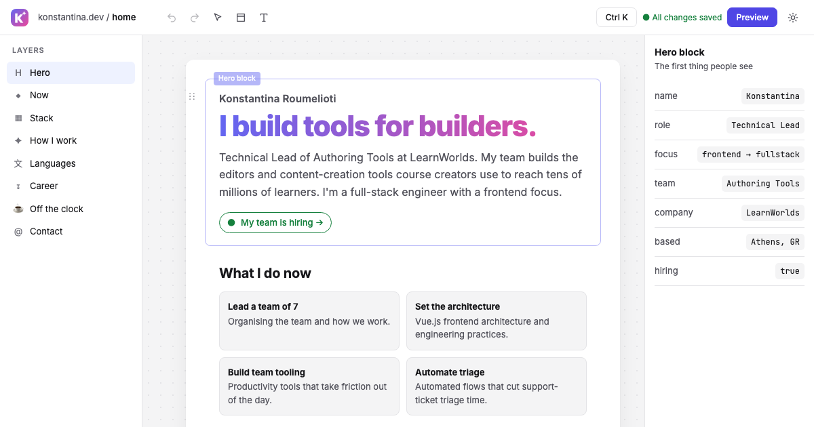

# konstantina.dev

My personal site, built to look and behave like a block editor. It opens as an editor: a layers panel on the left, the page as a stack of selectable blocks in the middle, and an inspector on the right. Click a block to select it, drag layers or press `Alt+↑` / `Alt+↓` to reorder, double-click a heading or paragraph to edit it, undo with `⌘Z`, and open the command palette with `⌘K`. Press **Preview** to see the page as a visitor would. Nothing you change is saved; reloading puts everything back.

**Live:** https://konstantina.dev



## Stack

- [Vue 3](https://vuejs.org) with `<script setup>` and TypeScript
- [Vite](https://vite.dev) and [vite-ssg](https://github.com/antfu-collective/vite-ssg) for a pre-rendered static build
- [Unhead](https://unhead.unjs.io) for `<head>` management (Vue Router is installed only because vite-ssg requires it as a peer dependency)
- Inter and JetBrains Mono, self-hosted via Fontsource
- [Vitest](https://vitest.dev) for unit tests, [Playwright](https://playwright.dev) with [axe-core](https://github.com/dequelabs/axe-core) for end-to-end and accessibility tests, [Lighthouse](https://github.com/GoogleChrome/lighthouse) for performance checks

## Getting started

```sh
npm install
npm run dev
```

The end-to-end tests need browsers: run `npx playwright install` once before `npm run e2e`.

| Script | What it does |
| --- | --- |
| `npm run dev` | Start the dev server |
| `npm run build` | Type-check and build the pre-rendered site into `dist/` |
| `npm run preview` | Serve the production build on port 4173 |
| `npm run typecheck` | Run `vue-tsc` |
| `npm test` | Run the unit tests |
| `npm run e2e` | Run the Playwright suite (desktop, Android and iPhone viewports, including axe accessibility checks) |
| `npm run og` | Regenerate the social card (`public/og.png`) |
| `bash scripts/lighthouse.sh` | Build, serve and run Lighthouse; fails if any score is below 95 |

## Content

All the text on the site lives in one file: `src/content/index.ts`. Edit it to update the site.

## Deploys

`npm run build` produces plain static files in `dist/`. Any static host works; the live site is served from Vercel.

## Accessibility

The editor chrome is keyboard operable, colours are designed to meet WCAG AA in both themes, motion respects `prefers-reduced-motion`, and preview mode is a plain, readable document. Axe checks run in the test suite on desktop and Android viewports, in light and dark themes, in editor and preview modes (plus the command palette and the mobile sheet). A keyboard-only journey is tested on desktop.

## License

Code: MIT. Personal content (text, name, images) © Konstantina Roumelioti, not covered by the license.
